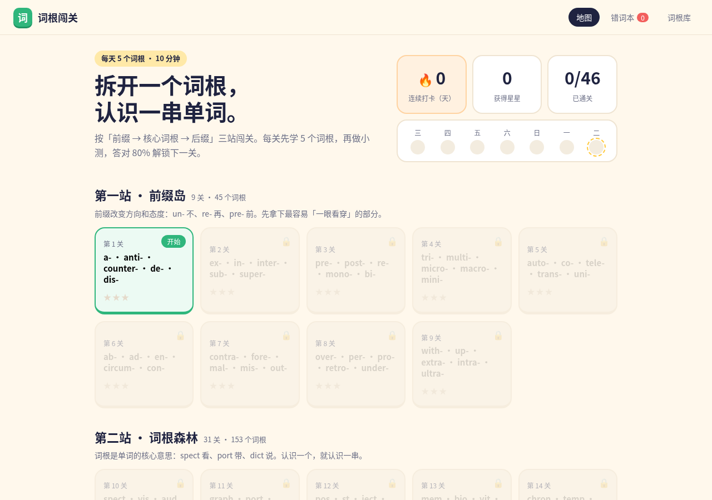

# 词根闯关 · 给初中生的单词冒险

> 拆开一个词根，认识一串单词。把「背单词」做成每天 10 分钟的闯关游戏。

**在线体验：** https://zouyue123321.github.io/word-root-quest/



## 这是什么

一个纯前端的英语词根学习小游戏。按「前缀岛 → 词根森林 → 后缀城堡」三站闯关，每关学 5 个词根，学完做小测，答对 80% 解锁下一关。学习数据只存在浏览器的 localStorage 里，不用注册登录。

## 目标用户

初中生（也适合准备中考的学生和陪读家长）。

## 用户痛点与产品思考

| 痛点 | 我的判断 | 设计 |
|---|---|---|
| 背单词靠死记，记了就忘 | 孤立记词没有「抓手」，词根能把一串词连起来 | 每张卡片先讲词根含义，再给例词拆分（高亮词根部分） |
| 原项目是「工具」，内容一次铺开 300 个词根，初中生不知道从哪开始 | 青少年需要明确的下一步和短反馈 | 拆成 46 个小关卡，一关 5 个词根，顺序解锁，当前关卡高亮「开始」 |
| 坚持不下去 | 习惯靠「连续」和「可见的进度」维持 | 连续打卡天数、最近 7 天打卡点、星星和通关数 |
| 错了也不知道错在哪 | 错题才是最有价值的复习材料 | 自动收集错词本，复习时连续答对 2 次才移出（简单的间隔强化） |
| 答题没有反馈 | 即时反馈比分数更重要 | 每题答完立刻告诉你正确答案和拆分记忆法 |

取舍：
- 不做账号、排行榜、社交：初中生使用场景多在家长手机/平板上，先把单人学习闭环做好，隐私也更简单。
- 小测题型只做「看拆分选中文」，干扰项来自其他词根的例词。题型少，但能直接检验「会不会用词根推词义」这个核心能力。
- 过关线定在 80%：太低没有挑战，太高容易挫败；3 星 = 全对，2 星 ≥ 90%。

## 闯关前先玩一玩（热身小游戏）

学完一关的 5 个词根后、小测之前，先玩两个热身小游戏（可随时跳过）：

- **① 拼词块**：给出中文意思和词根含义，把打乱的「前缀 / 词根 / 后缀」词块按顺序点出来，拼成单词
- **② 补词根**：遮住本关的前缀/词根/后缀，只给它的意思，学生自己补出字母

答错先给方向提示，再给具体提示，不直接揭晓答案；热身不计星、不进错词本，只为在小测前建立「词根 → 单词」的拆解直觉。每个词根取一个拆分能完整拼回原词的例词。

## 加餐关 · 情境单词

不是每个词都能靠词根拆开。地图上的「加餐关 · 情境单词」（`scene.html`）用 6 个初中重点词（below、repair、absent、amazing、effort、environment）做了一条「先懂意思再拼写」的路线：

1. **情境小游戏**：不先给中文。比如把小球拖到桌子下面（below）、对照点名单找出谁没来（absent）
2. **例句 + 记忆小提醒**，附带「和词根的关系」：absent = ab-（离去）+ sent；amazing = amaz(e) + -ing；environment = environ + -ment。below、repair、effort 不按词根硬拆，直接说明靠情境记
3. **补关键字母** → 六个词学完后**整词默写** → 学习小结

这些词的词义、例句和情境题来自我做的《初中英语475词·智能引导式单词记忆系统》。

## 我改编了什么

- **新增闯关首页**（`index.html`、`js/quest.js`、`css/quest.css`）：关卡地图、顺序解锁、星级评分、连续打卡、错词本、每关小测
- **数据清洗**：原数据集 `js/wordData.js` 第 231–300 条是占位数据（如 `root231`、`例词300a`），另有少量重复词根。闯关模式在加载时过滤掉这些条目，实际使用 228 个词根
- 原项目首页改名为 `classic.html`，原有的学习、闪卡、词根库、进度页面全部保留，并在导航里加入「闯关」入口
- 全中文界面，配色和组件为面向青少年重新设计

## 本地运行

纯静态页面，直接用任意静态服务器打开即可：

```bash
python3 -m http.server 8000
# 打开 http://localhost:8000
```

## 致谢

基于 [joeseesun/word-root-workshop](https://github.com/joeseesun/word-root-workshop)（词根词缀记忆工坊，作者 乔帮主，MIT License）改造。原项目的词根数据、学习页面和 LICENSE 均保留，原 README 见 [README.original.md](README.original.md)。
